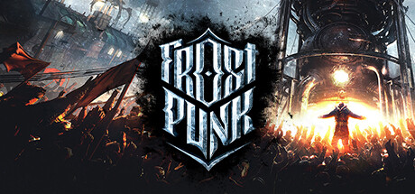

**Frostpunk is the city-builder survival game where you govern the last city on Earth around a massive coal generator during an endless ice age. Every decision involves moral compromise between survival and humanity, work hours, and child labor.**

---

## 📖 About

Frostpunk is the city-builder survival game where you govern the last city on Earth around a massive coal generator during an endless ice age. Every decision involves moral compromise between survival and humanity, work hours, and child labor.

## ⚠️ Problems Without Trainer

| Problem | Status |
|---------|--------|
| **Generator Heat** — Failing to maintain heat causes population illness and death within hours | ✅ Solved |
| **Food Production** — Maintaining adequate food supply while balancing coal use is the core tension | ✅ Solved |
| **Late Hope/Discontent** — Crossing hope zero or discontent maximum triggers instant game over | ✅ Solved |
| **Adaptation Timing** — Building adaptations in wrong order can leave critical systems vulnerable | ✅ Solved |

## ✅ Solution

The **Frostpunk Trainer** solves all these issues by giving you complete control over the game.

## 🎯 Full Feature List

- Unlimited Resources
- God Mode / Invincibility
- Instant Skill Cooldown
- One-Hit Kill
- Freeze Game Timer
- Unlock All Items & Achievements
- Custom Speed Multiplier
- Save State Anywhere

## 🚀 Quick Start

1. **Disable Windows Defender** temporarily (trainer may trigger false positive)
2. Download the trainer from the button above
3. Launch Frostpunk
4. Run the trainer as Administrator
5. Activate desired cheats with hotkeys

## 💎 Free vs Paid

| Feature | Free | Pro |
|---------|------|-----|
| Basic God Mode | ✅ | ✅ |
| Unlimited Resources | ✅ | ✅ |
| All Advanced Cheats | ❌ | ✅ |
| Auto-Updates | ❌ | ✅ |
| Priority Support | ❌ | ✅ |

## 💻 Requirements

- Windows 10/11 (64-bit)
- Frostpunk (any version)
- .NET Framework 4.8+
- DirectX 11+

## 🍎 macOS

macOS users can use our alternative tool:

## ⚖️ Legal

This trainer is for educational and single-player use only. Use responsibly.

---

